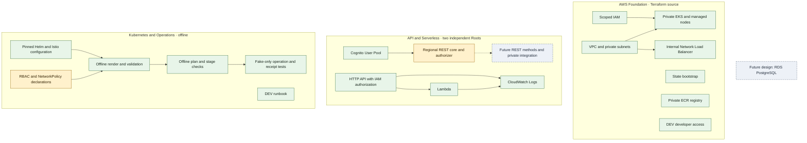

# AWS Terraform and Kubernetes Portfolio

## Project Overview

An infrastructure and platform engineering portfolio focused on reusable
Terraform, private AWS networking, and verifiable Kubernetes operations. The
implementation includes **15 Terraform Child Modules, 7 DEV Roots in
`ca-central-1`, and 5 GitHub Actions workflow definitions**. The evidence covers
source, offline tests, and selected AWS Emulator lifecycles. Live AWS and EKS
behavior is outside the verified scope.

[Release scope and inventory](docs/mvp-release-scope.md) ·
[Verification evidence](docs/mvp-release-evidence.md) ·
[Architecture v2](docs/architecture-v2.md)

## Architecture

The three scenarios illustrate separate design and verification boundaries.
Solid arrows show relationships declared in source. Dashed arrows identify
partial implementation or future design. A line does not represent measured
network traffic.

**Green** indicates source implemented for the shown scope. **Amber** indicates
a partial capability. The REST Root has a core and authorizer, and Kubernetes
policies have declarations and offline checks. **Dashed grey** indicates design
or future work. There is no deployed end-to-end path between these scenarios.
[Ownership and verification boundaries](docs/mvp-release-scope.md#scenario-boundaries)

## Technical Stack

| Layer | In this repository |
| --- | --- |
| Infrastructure | Terraform 1.17.0 workflow pin, AWS Provider 6.72.0 DEV locks, VPC, EKS, IAM, API Gateway, Cognito, Lambda, S3, ECR and CloudWatch Logs |
| Kubernetes | Helm and Istio, AWS Load Balancer Controller, TargetGroupBinding, RBAC and NetworkPolicy. Versions and hashes are in the [dependency lock](kubernetes/dependencies.lock.json) |
| Verification | Terraform Native mock plans, Python validators, render and schema checks, negative and mutation cases, and credential-free GitHub Actions |

## Engineering Highlights

- **Reusable infrastructure with explicit owners.** DEV Roots own provider,
  account and State configuration. Child Modules own resource behavior and
  validation. Terraform owns static load-balancer resources. The controller
  design owns dynamic target registration.
- **Security contracts in source.** Private endpoints and scoped IAM constrain
  access. Terraform manages Secrets Manager metadata. Secret values stay
  outside Terraform. Runtime source declares default-deny policies, restricted
  admission and separate Gateway and service-mesh TLS controls.
- **Operational checks with traceable evidence.** Offline plan, status, and
  Fake-only apply and destroy tests exercise preconditions, failure paths and
  receipts. The [runbook](docs/dev-runbook.md) distinguishes offline operations
  from future operator procedures that require separate approval.

## Repository Structure

| Path | Contents |
| --- | --- |
| [`infra/modules/`](infra/modules/) | Reusable Terraform Child Modules |
| [`infra/services/dev/ca-central-1/`](infra/services/dev/ca-central-1/) | Seven separately owned DEV Roots |
| [`kubernetes/`](kubernetes/) | Runtime configuration, dependency locks and render tests |
| [`scripts/`](scripts/) and [`tests/`](tests/) | Offline validators, operational tooling, CI policy and expected test counts |
| [`.github/workflows/`](.github/workflows/) | PR Safety CI, Full CI, Offline Contracts and two Emulator workflows |
| [`docs/`](docs/) | Architecture, verification records, runbooks and remaining decisions |

## Verification Results

| Evidence | Verified scope |
| --- | --- |
| [Terraform offline CI, run 43347607972](https://github.com/takayuki-ishida-engineer/aws-terraform-portfolio/actions/runs/43347607972), attempt 1, [`be79be6`](https://github.com/takayuki-ishida-engineer/aws-terraform-portfolio/commit/be79be6a64a6ef2e78f76e920afb335c59bbd49d) | Historical success: 781 Terraform Native tests, 153 Python toolkit tests and eight pinned Helm renders across two configurations. Counts apply to that commit. |
| [Step 2 Emulator rehearsal, run 44988721098](https://github.com/takayuki-ishida-engineer/aws-terraform-portfolio/actions/runs/44988721098), attempt 1, [`a3cf9bc`](https://github.com/takayuki-ishida-engineer/aws-terraform-portfolio/commit/a3cf9bcf4de277656c9664bb1a8bf91b57ee6b24) | Lifecycle and cleanup passed for 16 network resources without interface endpoints and seven API resources in the official AWS Emulator. |
| [Offline Contracts, run 45910291601](https://github.com/takayuki-ishida-engineer/aws-terraform-portfolio/actions/runs/45910291601), attempt 1, [`1a5e3d4`](https://github.com/takayuki-ishida-engineer/aws-terraform-portfolio/commit/1a5e3d41da208407caaf8ac9a4702c3458367a18) | Static, negative, mutation and evidence-ledger checks passed on the release source baseline. The run did not exercise a resource lifecycle. |

The [evidence record](docs/mvp-release-evidence.md) lists exact commits, tested
scope and limits, including Step 1 acceptance and the separately accepted
single-VPC demonstration. The [sanitized Emulator ledger](docs/evidence/emulator-runs/index.md)
retains run/attempt records beyond the lifetime of GitHub logs. Every PR uses
PR Safety CI. Full CI applies to the designated milestones and high-risk changes
defined in the [verification policy](docs/portfolio-verification-policy.md).

## Limitations and Roadmap

- Real AWS/EKS deployment, effective IAM, controller registration, Kubernetes
  packet enforcement, Cognito sign-in, REST invocation and end-to-end mTLS are
  unverified. `network-full` and `tfstate` have documented Emulator compatibility
  blockers. Kubernetes operations evidence covers the Fake-only engines.
- **After the initial release:** RDS PostgreSQL, the remaining REST methods and
  private integration, CloudFront/WAF, and the approved wider security,
  observability and operations scope. NP-2B and NP-3 remain paused.
- The initial release describes the existing implementation and its evidence.
  CORE PORTFOLIO COMPLETE and PORTFOLIO COMPLETE remain undeclared.

The [repository rules](AGENTS.md#repository-guidance), [Step 1 audit](docs/step1-audit-report.md)
and [Step 2 closure](docs/step2-emulator-rehearsals.md#closure-owner-decision-2026-11-24)
record the governing policy, decisions and residual risks. The
[previous README at the fixed baseline](https://github.com/takayuki-ishida-engineer/aws-terraform-portfolio/blob/1a5e3d41da208407caaf8ac9a4702c3458367a18/README.md)
preserves the original engineering history and historical verification snapshots.
