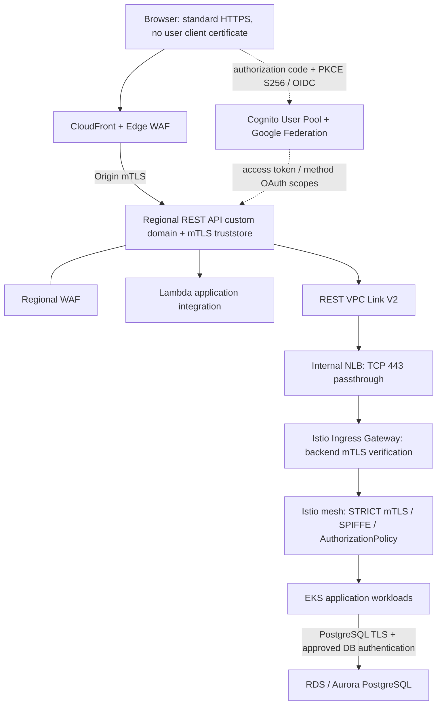

# Architecture v2 — Master Policy v10 alignment

See the [Network / State / Identity foundation design](architecture-v2-foundation-design.md) for proposed implementation ownership and staged PR boundaries.

## Authority, evidence and status

The approved Master Policy v10 (2026-11-08), as reproduced in this task and its
security/cost clarifications, is authoritative for the **design target**. The
separate PDF is not edited or required here. Repository source/CI remains the
authority for implemented behavior. No design statement is deployment evidence.
AWS Terraform is the primary portfolio; CloudFormation and Azure Terraform are
separate, smaller supporting portfolios, not implementations claimed here.

The implemented offline MVP still has nine modules, seven DEV workload instances,
17 resource definitions, AWS_IAM HTTP API, versioned S3 ZIP and no workload VPC
integration. Its accepted offline evidence remains unchanged in the
[technical history](../infra/README.md) and [acceptance audit](offline-mvp-acceptance.md).
Main `9a17e54b5842e05633c730510a2d46eda4f1e18a` has successful
[baseline CI 42546954252](https://github.com/takayuki-ishida-engineer/aws-terraform-portfolio/actions/runs/42546954252).
Historical 384 Terraform/153 Python results are not REST, NLB, Istio or mTLS
coverage. No target infrastructure is implemented by this documentation.

## Approved target topology



NLB replaces the previous proposed ALB ingress. Historical ALB discussion is not
the current approved target. No TLS terminates or authenticates a certificate at
the TCP NLB; Gateway terminates backend TLS. The diagram states intended boundaries,
not proven provider capability, connectivity or issuance.

## Transport, identity and authorization contracts

| Boundary | Approved target | OPEN implementation/evidence obligations |
| --- | --- | --- |
| Browser → CloudFront / Cognito | Standard HTTPS server authentication; ordinary users need no client certificates; Authorization Code + PKCE S256 / OIDC; environment-specific User Pools and Google federation | Exact callbacks/logout URLs, clients/scopes, claims, expiry/session/replay controls; distinguish browser PKCE from upstream Google federation |
| Viewer and login domains | AWS-provided *.cloudfront.net viewer domain permitted; keep Cognito AWS-managed login domain, no Cognito custom domain | No purchased viewer domain required; environment-specific callbacks must match actual endpoints |
| CloudFront → Regional REST API | Mandatory origin mTLS; ACM client certificate stored in us-east-1; publicly trusted API origin server certificate; ca-central-1 Regional custom domain with S3-versioned truststore | ClientAuth EKU/issuance, minimal trust, certificate identity/rotation, origin configuration, DNS compatibility and pricing feasibility; disable/prevent default execute-api endpoint bypass and review stage deployment behavior |
| REST API → Istio Gateway | Approved backend client certificate; ACM-backed REST stage certificate preferred subject to provider/private-integration verification; API verifies Gateway server chain and expected server name | Suitable client-auth certificate, backend trust/SNI/hostname mapping, rotation/expiry and endpoint validation; no insecureSkipVerification, unrestricted trust or plaintext fallback |
| VPC Link V2 → internal NLB → Gateway | Private integration; NLB TCP:443 passthrough; Gateway presents server certificate and verifies backend client certificate | Provider/link/NLB compatibility, subnet/SG rules, target mode, health checks and end-to-end TLS identity evidence |
| Controlled workload → workload | Istio STRICT mTLS, SPIFFE identities, short-lived workload certs, AuthorizationPolicy, restrictive RBAC/NetworkPolicy and appropriate default deny | Istio CA is initial candidate only; roots/intermediates, renewal/rotation/expiry, revocation-equivalent controls, ServiceAccount rights and principal boundaries require review |
| EKS → RDS/Aurora | PostgreSQL server TLS with CA and hostname verification; IAM DB auth or another explicitly approved scheme | Actual DB auth/credentials, trust, connections, failover/reconnection, backups/PITR and schema recovery |
| EKS/Lambda → AWS-managed APIs | Standard validated TLS with appropriate IAM/SigV4 | Scoped workload identity/permissions and actual service access; no custom certificate mTLS imposed |

Do not impose custom client-certificate mTLS on browser users, RDS standard
interfaces, local same-Pod communication or managed control planes. Transport
encryption, server authentication, client authentication, user authentication and
application authorization are separate. Encryption alone is not authenticated mTLS.

### API inbound certificate identity and revocation — OPEN

[API Gateway inbound mTLS documentation](https://docs.aws.amazon.com/apigateway/latest/developerguide/rest-api-mutual-tls.html)
describes supported certificate/chain/validity checks, but **API Gateway does not
automatically check certificate revocation status**. Trusting a CA does not restrict
access to the one expected CloudFront origin client certificate: other certificates
issued under that trust may validate. TLS handshake validation, certificate identity
authorization, revocation handling and Cognito user authorization must stay separate.

Before implementation, review the minimum necessary CA trust/issuance boundaries,
how the expected certificate is distinguished from other trusted-CA clients,
unauthorized-certificate denial, compromise response, rotation, expiry monitoring
and revocation-equivalent controls. Define any additional authorization mechanism's
owner, evidence, failure/availability behavior and coexistence with the approved
Cognito/scopes model. Do not assume a Lambda Authorizer alongside a Cognito User Pool Authorizer
can run on the same REST method. Although AWS describes Lambda authorizers as a
possible place for certificate checks, that is not approval or proof of compatibility
with this method model. No mechanism is selected; feasibility/security/operations
remain OPEN for its implementation PR. Short lifetimes or rotation alone must not
be advertised as an already implemented revocation control.

Protected methods use Cognito User Pool Authorizers with explicit OAuth scopes and
access tokens; ID tokens do not substitute for scoped API authorization. Backends
independently enforce user/tenant ownership, with wrong-owner and cross-tenant
negative cases. Regional WAF and edge WAF have separate scopes. The default
execute-api endpoint must not bypass custom-domain mTLS; disabling/redeployment,
custom domain mappings and direct-origin adversarial tests remain implementation
contracts. An obscured hostname or trusted CA alone is not origin protection.

### DNS, certificates and secrets — OPEN feasibility gates

API Gateway inbound mTLS requires a Regional custom domain. Prefer a suitable free
subdomain only after DNS control, validation, renewability, terms and technical
suitability are verified. No FQDN/provider is chosen; Route 53 need not own every
record. No domains/certificates are purchased or created here. If free-domain or
certificate feasibility fails, stop the relevant PR and obtain revised approval;
do not weaken TLS. Root-owned regional/global certificate/state boundaries remain
explicit; do not configure providers in children.

[CloudFront client-certificate requirements](https://docs.aws.amazon.com/AmazonCloudFront/latest/DeveloperGuide/origin-certificate-management-certificate-manager.html)
require clientAuth EKU and import into ACM us-east-1; issuance/renewal is not assumed
automatic. [API Gateway ACM backend certificates](https://docs.aws.amazon.com/apigateway/latest/developerguide/rest-api-acm-client-certificates.html)
require a suitable imported/private client-auth certificate in the API Region;
ordinary ACM public certificates must not be assumed usable. Actual provider and
VPC Link V2 integration support, truststore ownership and PKI are OPEN; no command
or certificate material is supplied here.

Google OAuth client secrets, DB credentials, keys and all actual secret values stay
outside Terraform inputs/data sources/plans/state/outputs, CI logs and repository
artifacts. Terraform manages Secrets Manager metadata only; approved external
processes own values/rotation. Sensitive marking or loading secrets through Terraform
does not prevent persistence. Secret-safe federation configuration and drift ownership
remain OPEN; no secret provisioning or ephemeral/write-only workaround is implemented.

## Infrastructure ownership and environment contract

Terraform owns VPC Link, internal NLB/listeners/target groups and network/subnet/
security resources. Kubernetes-side control owns Gateway Pod target registration.
TargetGroupBinding, controller permissions, Pod IP target mode, health checks and
NLB compatibility are OPEN. No independent Terraform/controller ownership of the
same load balancer is permitted. HPA owns replica scaling and Cluster Autoscaler
owns managed-node scaling under bounded policies; no concurrent Karpenter ownership.

| Property | DEV | STG / PROD |
| --- | --- | --- |
| Active application workload AZs | One to minimize cost; updates/worker failure downtime may be accepted | Two; separate Managed Node Group capacity per active AZ |
| Configured AZ subnets | Additional subnets wherever EKS, NLB, DB subnet groups or service constraints require them | Service-compliant subnets and IP headroom; configured AZ coverage is not workload capacity |
| NAT / egress | One NAT; private workloads; cost-reviewed endpoint selection | One NAT per active AZ (two); stronger private exposure and egress restrictions |
| Initial EC2-backed EKS capacity | One minimal worker only if Istiod, Gateway, sidecars, system pods, monitoring and application safely fit; increase if demonstrably insufficient | Redundant Istiod/Gateway/apps; adequate remaining-AZ capacity for defined peak after AZ loss, including CPU, memory, Pods, IPs and DB connections |
| Scaling / placement | Carefully bounded HPA + Cluster Autoscaler | HPA + Cluster Autoscaler, topology spread, PDBs, readiness and safe update headroom |
| Replica/node counts | One app replica initially if safe; resource sizing remains cost/capacity review | Two workers/replicas per AZ are candidates only, not fixed approved counts or resilience proof |
| Database | Single-AZ RDS PostgreSQL, validated TLS, backup and reviewed auth | Aurora PostgreSQL Provisioned writer/reader across AZs; failover/reconnection, backup/PITR, recovery and schema migration contracts |
| Observability | Limited CloudWatch/Fluent Bit/Datadog collection with retention/redaction/cost bounds | Strengthened monitoring/audit/retention and secret redaction |
| State/provider | Root-owned account restriction and local DEV state | Separate env/Region/service roots; separately reviewed remote state; providers root-owned |
| Portfolio evidence | Offline plus only feasible separately authorized limited DEV Live scenarios | Credential-free offline implementation verification only; no authenticated plan/apply or live tests required |

EKS cluster subnet coverage and DB subnet groups require multiple AZs even when
DEV application/database activity is Single-AZ; NLB subnet/target design must be
reviewed for its actual capabilities, not inherited ALB assumptions. No old ALB
/27 or two-subnet rule is used as a target acceptance criterion. Actual subnet,
node, controller, engine and service quotas remain OPEN. Two nodes/replicas alone
do not prove availability, safe updates or recovery. No measured SLA/RTO/RPO,
cross-region DR, cold standby or long-running production operations are in scope.
Older monthly environment budget examples are neither hard limits nor sizing approvals.

## Delivery, operations and shared notifications

- ECR releases pin immutable image digests and reviewed source/build provenance.
  GitHub Actions OIDC trust constrains audience/subject and repository/environment.
  CodeBuild deploys to private EKS using scoped IAM/RBAC and reviewed DNS/network
  connectivity; Helm/equivalent owns app releases, Terraform owns infrastructure.
- Lambda versions/aliases and code delivery need explicit single ownership between
  Terraform and release pipelines; the current publish=false MVP is not that flow.
  Review artifact digest, S3 version, provenance and ownership before bootstrap.
  User-provided dummy.zip is only a candidate, not an approved artifact. Never
  reuse/import/copy code or private information from the legacy customer-project ZIP.
- Verify release health and rollback to the known digest/version/alias. Database
  schema/connection recovery, infrastructure recovery and application rollback are
  distinct. Build/deploy/rollback successes and failures need correlated events;
  GitHub events do not automatically become EventBridge events.
- EventBridge routes defined events to notification Lambda; at least one destination
  is eventually verified within approved feasible DEV scope. Handle notification
  delivery failures independently through reviewed retry/redrive/alerting ownership.
  Telemetry includes CloudWatch, Fluent Bit and Datadog with scoped IAM, redaction,
  egress, retention and cost controls; no destination/key is invented here.
- Packer/Ansible own reviewed image/configuration provenance. Administration EC2
  is SSM-only, with no public SSH/RDP, and separately reviewed session permissions.

### Administration EC2 schedule and failure handling

```text
Timezone: America/Toronto
START: cron(0 8 ? * MON-FRI *)
STOP:  cron(0 19 ? * MON-FRI *)
```

Weekends remain stopped, with no special holiday calendar. Timezone-aware scheduling
handles daylight saving changes. Target flow: **EventBridge Scheduler → SQS Command
Queue → Controller Lambda → EC2 Start/Stop**. A separate Watchdog Lambda checks
expected versus actual state according to the local schedule.

Use CloudWatch detection and SNS notification for Scheduler delivery failures or
missing heartbeat, SQS retries/DLQ accumulation/stale commands, Controller errors/
timeouts/idempotency, EC2 API failures, failure to reach running/SSM-ready or stopped,
unexpected running outside schedule, and Watchdog/notification failures. Detect
both failure and non-execution of START and STOP. Thresholds, redrive counts,
permissions and precise recovery actions are OPEN; no implementation is selected.
This schedule is independent of the absolute DEV Live 72-hour complete-teardown
limit. Stopping EC2 does not stop EKS, NLB, NAT, RDS or other service billing.

## DEV Live feasibility and spending boundary

The limited Live policy is approved; specific execution, accounts, certificates,
scenarios and approvals are not. No AWS operations are authorized here. Actual
cumulative spending across the approved DEV validation period must stay within
**JPY 10,000**, and all testing plus independently verified complete teardown must
finish within **72 hours from approved live start**. A shorter run is preferable.

CloudFront Origin mTLS is supported on **Business, Premium and Pay-as-you-go**, not
Free; plan/feature availability is a mandatory pre-implementation/Live feasibility
gate. Review [plan feature availability](https://docs.aws.amazon.com/AmazonCloudFront/latest/DeveloperGuide/flat-rate-pricing-plan.html),
actual applicable fixed/usage charges, certificate issuance/renewal and all other
service costs. No plan is selected or purchased. Estimate Region/runtime, tax,
currency conversion, retained charges, contingency and teardown implications.
A 72-hour window does not guarantee affordability. If a validated estimate cannot
fit the cap, do not authorize that scenario: leave it OPEN or Offline-only.
Budgets/alerts are not real-time enforcement or guaranteed billing cutoff; use
monitoring, resource inventory, manual stop authority and a reviewed timeline.

Prioritize feasible creation/resource inventory, positive/negative Istio STRICT
mTLS, then REST VPC Link V2/NLB/Gateway backend certificate authentication. Delivery,
rollback and notifications run only in remaining approved scope/budget. Do not
mandate full simultaneous CloudFront/Cognito/RDS/delivery integration if infeasible.
Unexecuted scenarios never pass. All seven readiness gates remain OPEN; see the
[Live readiness assessment](dev-live-validation-readiness.md) and
[verification policy](portfolio-verification-policy.md) for complete deletion criteria.

## Migration register — approved target, implementation OPEN

| Existing offline baseline / earlier design | Required migration | Preserve / independently verify |
| --- | --- | --- |
| HTTP API AWS_IAM | New REST/Cognito scopes, two mTLS boundaries, WAF and custom domain | Keep HTTP API module/tests; new trust/identity/revocation/bypass and user/tenant authorization evidence |
| Earlier proposed ALB ingress | Internal NLB TCP:443 → Istio Gateway → STRICT mesh | New VPC Link/provider/target ownership, TLS/SNI, SPIFFE and PKI verification; no ALB substitution |
| S3-versioned ZIP, publish=false | Reviewed bootstrap then single-owned code/version/alias release flow | Keep artifact/execution security contracts and exact version requirement until approved migration; dummy.zip not approved |
| Independent VPC; no workload mesh/database | New environment network/EKS/mesh and RDS/Aurora | New scoped modules and offline security/capacity/recovery contracts; no historical test count implies coverage |
| Offline-only CI | OIDC/ECR/private CodeBuild, notifications, EC2 Scheduler/SQS/Controller/Watchdog/SNS | Keep complete offline suite; separately scoped delivery/admin roles and failure evidence |
| DEV local state, root account guard; STG/PROD placeholders | Env/Region/service state/provider boundaries and reviewed STG/PROD remote state | Exclusive resource ownership and migration; no backend change here |
| Metadata/log/IAM modules and accepted 17-resource MVP | Reuse only compatible parts after review | Keep all history/tests; 17 is not v2's resource inventory or a cost/teardown guarantee |

Implementation blockers remain OPEN: provider/integration support; PKI/issuance
and identity/revocation feasibility compatible with Cognito; free DNS and truststore
ownership; TargetGroupBinding/permissions; sizing; state/IAM; artifact provenance;
monitoring thresholds; plan pricing and full deletion within 72 hours. The current
secret module's 30-day recovery is incompatible with actual complete deletion in
72 hours if that unchanged resource is created for Live. Do not execute the full
historical root unchanged under the new limit; an approved feasible scenario/lifecycle
design is needed first, without silently weakening existing guards. Avoid new CMKs
or other unavoidable deletion delays. Prior [bootstrap proposals](dev-bootstrap-decision-plan.md)
remain historical decision inputs, not authorization or current ingress overrides.
