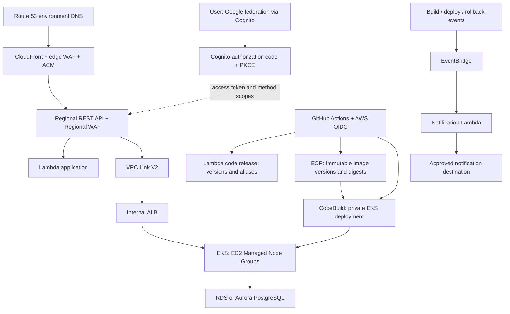

# Architecture v2 — AWS Terraform portfolio baseline

## Status and authority

This document defines the requested **target**, not implemented infrastructure or
execution approval. AWS Terraform is the primary portfolio. AWS CloudFormation
and Azure Terraform are smaller, separate supporting portfolios with no claimed
implementation here. Confirmed choices below are documentation design selections;
they are not completed AWS configurations. Unresolved mechanisms remain OPEN.

Current implemented baseline: nine reusable modules, seven DEV workload instances,
17 managed resource definitions, an AWS_IAM HTTP API, S3-versioned Lambda ZIP,
metadata-only secrets and local dev state. It has offline evidence only. Preserve
all modules, tests and historical evidence in the [technical history](../infra/README.md)
and [acceptance audit](offline-mvp-acceptance.md) until separate migration approval.
Baseline main is `734ee0d0a56bbecd025b132b2b415f386bb38776`, with successful
[post-merge CI 42532930733](https://github.com/takayuki-ishida-engineer/aws-terraform-portfolio/actions/runs/42532930733).
No v2 live result is inferred from that CI. Portfolio completion is governed by
the [verification policy](portfolio-verification-policy.md).

## Target topology and responsibility

The diagram is a target dependency/routing view, not an assertion that REST or
Cognito already exists. Protected methods route to either Lambda or a private
integration, with no invented implementation of path or method mappings.

| Target component | Boundary and planned owner | Remaining decisions |
| --- | --- | --- |
| Route 53, CloudFront, ACM, two WAF scopes | Terraform owns DNS, distribution, certificates and security resources | Domain ownership, origin protection, environment certificates, WAF rules/costs and certificate/global-region state |
| Regional REST API / Cognito | Terraform owns API methods/scopes, authorizer, User Pool and non-secret client configuration | Exact methods/scopes, Google provider/client provisioning without plaintext state, token/session controls |
| Lambda application and notification functions | Terraform owns infrastructure and execution IAM; application pipelines own releases | Bootstrap artifact, version/alias ownership, destinations, failure policy and release verification |
| VPC Link V2, internal ALB, EKS EC2 Managed Node Groups | Terraform owns network/cluster/node infrastructure; application release mechanism owns workloads | Provider support, subnet/IP sizing, endpoint/SG rules, ALB target/controller ownership and node sizing |
| ECR | Terraform owns repository and retention/security configuration; CI owns images | Tag immutability/retention/scanning and build provenance; releases pin digests |
| PostgreSQL | Terraform owns RDS/Aurora infrastructure | Engine/version, credentials outside state, sizes, subnet/SG rules, backup/recovery and migration ownership |
| Fluent Bit and Datadog | Reviewed platform/add-on configuration owns telemetry; keys outside Terraform state | Collection/destination, redaction, retention, agent/controller permissions and cost; no API key configured |
| SSM-only administration EC2 | Terraform infrastructure; Packer owns approved image build; Ansible owns reviewed OS configuration | Session IAM/logging, patch/image lifecycle and SSM connectivity; no public SSH or inbound administration |
| GitHub Actions OIDC / CodeBuild | Future pipelines use scoped temporary AWS roles; CodeBuild has private EKS connectivity | Trust conditions, deployment rights, private endpoint/DNS/egress and release locks |
| EventBridge / notification Lambda | Terraform owns event infrastructure; pipelines publish defined outcomes | Event schema/sources, correlation/idempotency, destination, retries/DLQ and delivery evidence |

No public worker/database endpoints are intended. Exact routing, security groups,
private service endpoints, egress and dependency access must be reviewed rather
than assumed covered by NAT or the existing independent VPC module.

## Environment contract

“Active workload AZ” means application worker/replica placement, not the number
of configured network or AWS-managed service AZs. Managed service control-plane,
load-balancer or storage placement can span more AZs than active application nodes.

| Property | DEV target | STG target | PROD target |
| --- | --- | --- | --- |
| Active workload AZs | One | Two | Two |
| Configured subnets/AZs | Additional AZ subnets for EKS control-plane connectivity, ALB and DB subnet group requirements | At least two, with service-required additional coverage | At least two, with service-required additional coverage |
| NAT Gateways | One; no AZ-redundancy claim | Two, one per active AZ | Two, one per active AZ |
| EKS workers | EC2 Managed Node Group, one minimal viable worker initially in active AZ | EC2 Managed Node Groups spanning two AZs | EC2 Managed Node Groups spanning two AZs |
| Application replicas | One by default | At least two distributed across AZs | At least two distributed across AZs |
| Database | Single-AZ RDS PostgreSQL | Aurora PostgreSQL Provisioned writer + reader in separate AZs | Aurora PostgreSQL Provisioned writer + reader in separate AZs |
| Intended capacity | Minimal integration testing, subject to system/add-on resource needs | System, recovery, monitoring and failover test design | Production-oriented security, monitoring and resilience design |
| Portfolio live requirement | Limited evidence only after separate external approval | No apply, authenticated plan or live tests required | No apply, authenticated plan or live tests required |

Service constraints checked against official documentation:

- [EKS subnet requirements](https://docs.aws.amazon.com/eks/latest/userguide/network-reqs.html): cluster subnets span at least two AZs; IP capacity and supported AZs must be checked. DEV node placement can be one AZ while configured cluster subnets span multiple AZs. One worker must fit system pods, add-ons and application; instance type and headroom are OPEN, and disruption/upgrade downtime is expected rather than hidden.
- [ALB subnet requirements](https://docs.aws.amazon.com/elasticloadbalancing/latest/application/application-load-balancers.html): standard regional ALBs require at least two different AZ subnets, with at least /27 and eight free addresses per subnet for scaling. An ALB spanning two AZs does not imply DEV application targets exist in both. Target mode, health checks, cross-zone behavior, controller integration and drain/upgrade design need review.
- [RDS VPC requirements](https://docs.aws.amazon.com/AmazonRDS/latest/UserGuide/USER_VPC.WorkingWithRDSInstanceinaVPC.html): a DB subnet group covers at least two AZs even for a Single-AZ DB. STG/PROD Aurora writer/reader placement is distinct from Aurora's managed storage topology; it is not a two-AZ-only storage or DR guarantee. Aurora-specific subnet/storage constraints, capacity and engine availability remain an implementation review gate.
- [REST private integrations](https://docs.aws.amazon.com/apigateway/latest/developerguide/private-integration.html): VPC links V2 support REST APIs to ALBs without an NLB. Validate chosen Terraform/provider version support, account/Region alignment, link subnet/security-group and integration mappings before implementation. Existing HTTP API tests do not verify REST behavior.
- [CloudFront certificate requirements](https://docs.aws.amazon.com/AmazonCloudFront/latest/DeveloperGuide/cnames-and-https-requirements.html): viewer ACM certificates require us-east-1. Workload regional certificates, edge-scope WAF configuration and DNS/global resources need explicit root-owned provider/state boundaries; do not silently put everything in ca-central-1 or introduce aliases in child modules.

These are design constraints, not provisioned network facts. STG/PROD replica
spread needs explicit scheduling/topology and capacity controls; two replicas
alone do not prove AZ diversity. Aurora reader placement does not prove tested
failover or application recovery. AZ-specific NAT routing, IP growth, private
EKS access and administration endpoint/egress needs remain design gates. No
availability percentage, RTO/RPO, backup recovery or cross-region DR guarantee is
claimed. Cross-region replication/DR remains outside permanent repository scope.

## Authentication, routing and secret ownership

Confirmed target: CloudFront → Regional API Gateway REST API → Lambda **or**
VPC Link V2 → internal ALB → EKS. Attach CloudFront-scoped WAF at the edge and a
Regional WAF to the REST API stage through separately reviewed implementations.
Use environment-specific domains/callback URLs, TLS certificates and Cognito
client configuration; validate exact callbacks/logout URLs without broad wildcards.

Cognito User Pool federates Google through its OIDC identity flow. Application
clients use Authorization Code with PKCE (S256); the browser/client-to-Cognito
PKCE boundary must be distinguished from Cognito's upstream Google federation.
Do not claim upstream provider/client registration or PKCE enforcement is complete.
Protected REST methods configure a Cognito User Pool Authorizer and explicit
OAuth scopes; use **access tokens**, not ID tokens, for scope-protected method
calls. Scope names/method mapping, audience/client binding, expiry, issuer and
replay/session behavior require review and positive/negative verification.

The backend independently enforces tenant/user resource ownership on every
protected operation. A valid token or broad method scope does not grant access
to another user's records. Define claims/ownership mapping and denial tests.
Service ingress and workload identity remain separate from human administration,
CI deployment, artifact upload and API-client permissions.

**OPEN — Google OAuth secret provisioning:** registering Google federation may
require a confidential Google client secret on the service-side provider. Store
and rotate real values externally; never load plaintext through Terraform variables,
data sources, provider arguments, plans or state. Marking a variable sensitive or
reading Secrets Manager through Terraform does not solve state persistence.
Select and review an external provisioning/rotation ownership boundary and drift
handling for the provider's secret-bearing fields before implementation. Do not
assume a resource reference, dynamic reference, ephemeral/write-only workaround
or PKCE eliminates this secret. This PR implements none of those mechanisms.

**OPEN — direct origin access:** a Regional REST API origin can be reached
without CloudFront. Edge WAF alone is therefore insufficient. Regional WAF and
Cognito still apply to direct calls, but are not proof of edge-only ingress.
Decide whether residual direct-origin access is accepted or enforce a reviewed
origin restriction with rotation, forwarding/header behavior and bypass tests.
DNS/custom domain, an undisclosed hostname or a proposed origin header alone is
not a demonstrated control. Exact default-endpoint/custom-domain policy is OPEN.
Do not advertise completed origin protection or Google federation.

## Delivery, rollback and observability ownership

### Lambda

Target Terraform owns function configuration, execution IAM and infrastructure.
An approved minimal initial ZIP may bootstrap a future function; this is a target
allowance, not an artifact added here or a waiver of current exact-version inputs.
The existing root still requires an approved external versioned S3 artifact.
GitHub Actions subsequently owns application build/code delivery and version/alias
release management. Define a single owner for every mutable code/alias field,
review Terraform drift/reconciliation behavior and exact provider capabilities
before migration; do not add ignore_changes or competing release writers here.
Versions and aliases support release/rollback; the current module has publish=false
and no alias, so it cannot be described as already providing that delivery flow.
Container images through ECR remain an optional separately reviewed alternative.

### EKS

GitHub Actions builds/tests a container and publishes it to ECR with controlled
immutable tags/provenance. Deployments reference an immutable **image digest**.
CodeBuild executes authorized Helm or equivalent reviewed releases with private
EKS connectivity; it needs scoped cluster access, deployment IAM, DNS/network
paths and restricted build inputs. OIDC role trust must constrain repository,
branch/environment and audience; no unrestricted trust or stored AWS access keys.
Terraform owns infrastructure while the release mechanism owns Kubernetes app
objects; decide controller/add-on and ALB ownership without two reconcilers.

Health verification must establish readiness and relevant connectivity before a
release is accepted. Keep a prior digest/release record and verify rollback to it;
an attempted rollback is not successful recovery evidence. Database schema changes
need backward/forward compatibility and a separate recovery procedure. Packer and
Ansible changes need image/config provenance; SSM access requires approved session
permissions and connectivity, not SSH fallback.

### Notifications and telemetry

Capture build, deployment and rollback outcomes (including failures) from both
Lambda and EKS pipelines. Define event schemas/correlation and publish sources
explicitly; do not assume every GitHub event appears in EventBridge automatically.
EventBridge routes reviewed events to a notification Lambda. At least one approved
notification destination must be configured and verified on DEV in future work.
Credentials/destination secrets stay outside Terraform state. Define retry, error
isolation, dead-letter handling or equivalent redrive and delivery-failure alerts;
notification failure must not silently change or hide deployment outcome.

Fluent Bit and Datadog collection/agent placement, IAM, redaction, retention,
network egress and cost controls need a reviewed design, especially with one DEV
worker. Infrastructure recovery, application rollback and database recovery are
three distinct procedures; notification success proves none of them.

## Migration register and approval boundaries

| Existing offline MVP | Target / migration needed | Reuse and verification boundary | Status |
| --- | --- | --- | --- |
| AWS_IAM HTTP API, five API/permission resources | New REST API and Cognito method scopes, WAF and new integration mappings | Keep HTTP module/tests; new contracts and live auth/routing evidence required; do not relabel existing tests as REST tests | Proposed; implementation approval OPEN |
| S3 ZIP key/version, publish=false, no alias | Initial approved ZIP then GitHub Actions versions/aliases delivery | Reuse artifact bucket and execution-role security contracts where compatible; approve code/alias ownership and full-plan drift behavior | Proposed; release ownership OPEN |
| Independent VPC module, no workload VPC attachment | New multi-environment network, VPC Link V2, internal ALB and EC2 EKS | Assess reusable VPC components; no assumption existing module meets all subnet/endpoint constraints | Defined target; detailed design OPEN |
| No workload database | New DEV RDS PostgreSQL; STG/PROD Aurora Provisioned | New modules, credentials outside state, backup/schema/recovery contracts and tests | Defined target; implementation OPEN |
| No CloudFront/WAF/Cognito stack | New DNS/certificates/edge and regional security/auth modules | New account/global-region ownership, secret-safe federation and origin restrictions | Defined target; mechanisms OPEN |
| Offline-only GitHub Actions | New OIDC build/release roles, ECR, private CodeBuild deployment, EventBridge notifications | Keep offline workflow/security gates intact; new separately scoped delivery work and DEV evidence | Proposed; deployment authorization OPEN |
| DEV local state and root account guard; STG/PROD placeholders | Separate env/Region/service roots; STG/PROD remote-state design; explicit edge-region providers | Preserve root-owned providers/backends and account guards; approve each state owner/migration independently | Existing boundaries retained; new roots/backends OPEN |
| Metadata-only secrets, log storage and least-privilege IAM modules | Reuse compatible defaults; extend only for reviewed new responsibilities | Keep current modules/history and all positive/negative/security evidence until separately approved extension/replacement | Existing implemented offline; no deletion authorized |

Unresolved blockers: dedicated approved account/identity/cost boundaries; state and
artifact bootstrap decisions; application/runtime packaging; provider support for
REST VPC Link V2; exact subnet/node/database sizing and service availability;
Google secret-safe provisioning; origin bypass decision; release/controller
ownership; database credentials/recovery; external telemetry and notifications.
Use the [bootstrap decision plan](dev-bootstrap-decision-plan.md) and existing
[live readiness gates](dev-live-validation-readiness.md); they remain OPEN.
No live plan, apply, deployment or migration is authorized by this baseline.
