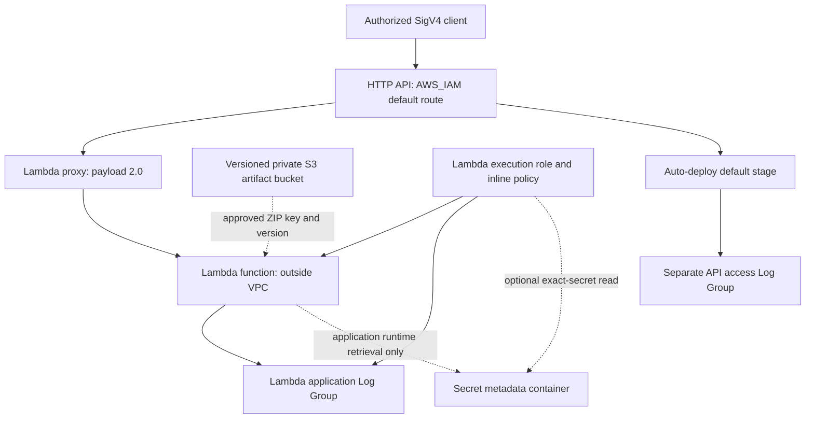

# Development serverless API integration

See the [offline MVP acceptance audit](../../../../../docs/offline-mvp-acceptance.md)
and [live-validation approval gates](../../../../../docs/dev-live-validation-readiness.md).
These documents authorize no live AWS operations.

This root describes one `dev` / `ca-central-1` / `serverless-api` workload for
the project given by the `project` input. R2 composes four functional module
instances into a 17-resource configuration. Validation uses offline mocked plans;
no AWS infrastructure is deployed, authenticated or established as operational.

**This root cannot bootstrap an empty account in one operation.** Its Lambda
requires an approved ZIP that has already been published to the versioned artifact
bucket. The configuration does not package, upload, discover or inspect artifacts.
It is not production-ready or a deployment procedure.

## Input values (Step 1 item 3)

Values follow the [deployment configuration](../../../../../docs/deployment-configuration.md#1-where-values-live). The committed
`terraform.tfvars` holds every required input; environment-specific inputs there
are documented placeholders. Copy `local.auto.tfvars.example` to the untracked
`local.auto.tfvars` and set the real values: `project`, `aws_account_id` and `artifact_object_version` (the uploaded ZIP version). The
[local workflow](../../../../../scripts/local-workflow/README.md) preflight refuses a plan or apply while any of them is
missing locally or still a placeholder. Full CI plans this root with the committed
values under mocks. Never put a credential or secret value in any tfvars file.

| Committed value | Setting |
| --- | --- |
| Lambda | `python3.13`, handler `main.handler`, artifact key `lambda/function.zip` |
| Secret read | Disabled (`features.auto.tfvars`) |

## Architecture and ownership



The root owns provider selection, account restriction, local state, workload
selection, stable names and environment overrides. Child modules own resources,
input validation, secure defaults and outputs. There are no AWS data sources,
VPC/Identity Center/human-access/account-policy module instances, additional
accounts, provider aliases or additional Regions in this workload.

### Exact R2 module and managed-resource inventory

All resource addresses below are relative to the stated module instance. Every
resource is named `this`; successful complete mock plans contain exactly **17**.

| Module instance | Source under `infra/modules/` | Managed resource types | Count |
| --- | --- | --- | ---: |
| `module.artifact_bucket` | `s3_artifact_bucket` | `aws_s3_bucket`, `aws_s3_bucket_versioning`, `aws_s3_bucket_public_access_block`, `aws_s3_bucket_ownership_controls`, `aws_s3_bucket_server_side_encryption_configuration`, `aws_s3_bucket_policy` | 6 |
| `module.secret_metadata` | `secrets_manager` | `aws_secretsmanager_secret` | 1 |
| `module.lambda_workload` | `lambda_workload` | `aws_lambda_function`, `aws_iam_role`, `aws_iam_role_policy`, `aws_cloudwatch_log_group` | 4 |
| `module.http_api` | `api_gateway_http` | `aws_apigatewayv2_api`, `aws_apigatewayv2_integration`, `aws_apigatewayv2_route`, `aws_apigatewayv2_stage`, `aws_lambda_permission`, `aws_cloudwatch_log_group` | 6 |
| **Total** | **Four instances, four module sources** | **No objects, secret versions or extra policies** | **17** |

## Root input contract

Required inputs have no production defaults. Supply non-secret references only
through an approved future workflow outside Codex Cloud. Tests use synthetic
values that identify no verified account, bucket, artifact or deployment.

| Input | Contract |
| --- | --- |
| `aws_account_id` | Required non-null 12-digit expected workload account, also used by the provider account restriction |
| `project` | Required project name (1–10 lowercase characters, starting with a letter, without aws/amazon/cognito; tracked placeholder `project`); every name below and the `project` tag derive from it. It replaces the former `artifact_bucket_name` input |
| `artifact_key` | Required exact approved ZIP object key; child validation rejects blank values, URI prefixes, controls and keys exceeding 1024 UTF-8 bytes |
| `artifact_object_version` | Required immutable S3 object version; child validation rejects null, blank/whitespace, the `null` version sentinel and invalid/oversized values; this is not a Lambda function version |
| `lambda_runtime` | Required reviewed runtime: `nodejs22.x`, `python3.13` or `java21` |
| `lambda_handler` | Required handler selected for that ZIP; child validation checks runtime-specific syntax, not artifact contents or executable compatibility |
| `enable_secret_read` | Optional boolean, default `false`, non-null; the tracked feature file explicitly keeps it disabled |

No input accepts secret plaintext, credentials, access keys, tokens, passwords,
confidential application configuration or arbitrary module options. Do not put a
real account, private-account bucket, actual artifact version or secrets in tracked
`.tfvars` files. `features.auto.tfvars` is exclusively non-secret feature policy.

### Stable names

Names follow [deployment configuration](../../../../../docs/deployment-configuration.md#4-resource-naming)
`<project>-dev-<type>[-<purpose>]`, with the path form `/<project>/dev/<type>/<purpose>`
for the secret and the API access log group (**Root Override**). There is no random
name, uniqueness suffix or reconstructed provider ARN; the placeholder `project` would
collide in real AWS, so replace it first.

| Resource purpose | Name | `service` tag |
| --- | --- | --- |
| S3 artifact bucket | `<project>-dev-s3-artifact` | `s3` |
| Secret metadata | `/<project>/dev/secret/app` | `secret` |
| Lambda | `<project>-dev-lambda` | `lambda` |
| Execution role / inline policy | `<project>-dev-role-lambda` / `<project>-dev-policy-lambda` | `role` |
| Lambda application logs | `/aws/lambda/<project>-dev-lambda` (AWS-mandated prefix) | `lambda` |
| HTTP API / `$default` stage | `<project>-dev-apigw-http` / Name tag `<project>-dev-apigw-http-default` | `apigw` |
| API access logs | `/<project>/dev/apigw/http` | `apigw` |

Each child module sets the `Name` and `service` tags (**Module Fixed**).

These names fit the existing modules' distinct name constraints. A valid format
does not establish ownership or availability in a real account.

## Effective configuration and sources

R1 owns function, dedicated role/policy and Lambda application logs together.
R2 owns API access logs directly inside http_api; generic logging remains independently tested with no DEV root consumer.

**Root Override** means an explicit child input supplied by this root, overriding
a child default where one exists. **Module Default** means an omitted child input
inherits its declared default. **Module Fixed** means the child implementation
offers no override. Fixed root/provider settings are documented separately and
are not mislabeled as child defaults.

| Root-owned setting | Effective value/source |
| --- | --- |
| Identity | Fixed locals `dev` and `ca-central-1`; `name_prefix = <project>-dev`, `path_prefix = /<project>/dev` |
| Provider | Root-owned default `hashicorp/aws`; fixed Region; `allowed_account_ids = [var.aws_account_id]` |
| Provider default tags | `project = <project>`, `env = dev`, `managed = terraform` ([tag keys](../../../../../docs/deployment-configuration.md#5-tags)); modules own `Name` and `service`; the secret also carries the module-owned `project` authorization tag |
| Terraform/provider versions | CLI `~> 1.17.0`, AWS `~> 6.72.0`; unchanged committed lock selects AWS 6.72.0 |
| State | Explicit local backend, default root-local `terraform.tfstate`; isolated by environment/Region/service |

| Module setting | Effective value | Source |
| --- | --- | --- |
| All required stable names | Names above; S3 name remains caller-supplied | Root Override |
| Secret `project_tag` | `local.project` authorization identity | Root Override |
| Role partition/account/Region | `aws`, `var.aws_account_id`, `local.region` | Root Override |
| Role log group | Actual internally owned bare group ARN | Module Fixed |
| Role secret read | Root flag; actual secret ARN only when enabled, otherwise null; customer-managed key reference null | Root Override |
| Lambda role/log group and policy binding | Actual internally owned role ARN, bare group ARN/name; function waits for inline policy | Module Fixed |
| Lambda artifact | Actual bucket-name output, explicit input key and object version | Root Override |
| Lambda runtime/handler | Explicit required root inputs | Root Override |
| Lambda environment | Empty when disabled; only `SECRET_ARN` with actual secret ARN when enabled | Root Override |
| API Lambda references | Actual Lambda function and invocation ARN outputs | Root Override |
| API log destination | Actual internally owned API Log Group's bare ARN | Module Fixed |
| Both Log Groups | 30-day retention; deletion protection true; CMK null (`log_*` workload inputs versus access_log_* HTTP API inputs) | Module Default |
| Both Log Groups | `STANDARD`, `skip_destroy = false` | Module Fixed |
| Secret recovery window | 7 days (decision in [deployment configuration §9](../../../../../docs/deployment-configuration.md#9-step-1-operational-decisions-owner-2026-11-16)) | Root Override |
| Secret encryption/description | No explicit CMK; optional description null | Module Default |
| Secret metadata tags | Canonical `Name` and the module-owned `project` authorization tag | Module Fixed |
| Extra module tags | Empty maps; root provider tags still apply | Module Default |
| S3 | Global namespace, versioning Enabled, all four public-access blocks true, BucketOwnerEnforced, AES256/SSE-S3, `force_destroy = false`, HTTPS Deny with service-principal exception | Module Fixed |
| Role | Lambda-only trust, path `/`, max session 3600 seconds, one inline policy named `<project>-dev-policy-lambda` (Root Override) | Module Fixed |
| Role logging permissions | Only `logs:CreateLogStream` and `logs:PutLogEvents` beneath the actual Lambda Log Group's `:log-stream:*` scope | Module Fixed |
| Optional role secret permissions | Only `secretsmanager:GetSecretValue` and `secretsmanager:DescribeSecret` on the actual exact secret; no KMS statement in this root | Module Fixed policy, root-controlled flag/reference |
| Lambda compute | x86_64, 128 MB, timeout 10 seconds, temporary storage 512 MB | Module Default |
| Lambda optional settings | No layers, subnets or security groups; reserved concurrency null; description null | Module Default |
| Lambda deployment/logging | ZIP package, publish false, Text logs, PassThrough tracing | Module Fixed |
| API entry point | HTTP v2; AWS_PROXY/POST payload 2.0, INTERNET connection; endpoint enabled | Module Fixed |
| API route/stage | `$default`, `AWS_IAM`; `$default` auto-deploy stage | Module Fixed |
| API protection/logging | 10 requests/second, burst 20; seven metadata-only access-log fields | Module Fixed |
| API invoke permission | `lambda:InvokeFunction`, `apigateway.amazonaws.com`, exact actual function, actual API execution ARN + `/$default/$default`; API-derived statement ID | Module Fixed |

No remote backend, provider aliases, credential configuration, CMK, network
resources, deployment identity or human IAM permissions are added. Mock provider
execution does not authenticate an account or exercise `allowed_account_ids`.
Real identity verification remains an external requirement.

## References, ordering and permissions

Actual output references carry these dependencies:

1. The artifact bucket's output waits for versioning, encryption, public-access
   blocking, ownership and bucket policy before Lambda consumes the bucket name.
2. Lambda application Log Group outputs feed the role's exact stream policy and
   Lambda's logging configuration. They are never reconstructed as ARN strings.
3. The real secret ARN feeds exact-secret IAM policy and `SECRET_ARN` only when
   enabled. Secrets Manager assigns its suffix; the root never invents it.
4. Internally owned log/role outputs feed the policy/function. The integrated
   function explicitly depends on its inline policy before creation; it does not
   prove IAM propagation.
5. Lambda's actual function and invocation ARNs feed the HTTP API integration and
   its resource-based invoke permission.
6. The distinct API access Log Group's bare ARN feeds stage access logging.
7. The existing API module orders stage activation after route and invoke
   permission; its outputs also wait for stage and permission.

These Terraform dependencies do not prove S3 propagation, artifact existence,
initialized secret values, service authorization, log delivery or readiness.
There are no broad root-wide dependencies or dependency cycles.

Keep three permission boundaries separate: the externally approved human
deployment principal, Lambda's workload execution role, and API Gateway's
resource-based Lambda invocation permission. This root grants no human
`iam:PassRole`, S3 artifact-read/upload access or unrestricted IAM. Lambda's role
does not need artifact access merely because its deployment ZIP is stored in S3.
An authorized deployment principal's artifact permissions require separate review.

### Optional runtime secret access

The metadata container always exists in the configuration. With
`enable_secret_read = false`, the execution role receives `secret_arn = null`,
has no Secrets Manager/KMS permissions, and Lambda has no secret-reference
environment variable. With the flag true, the exact actual secret ARN is used
for the two read actions above and for the non-secret `SECRET_ARN` reference.
No customer-managed KMS decrypt grant is configured in either case.

Changing this flag changes authorization and Lambda configuration; review the
resulting real plan through a separately authorized external workflow before any
deployment. The application must implement runtime retrieval through the AWS SDK.
Terraform owns metadata only: no secret value, secret version, rotation, replica,
resource policy, generated password or initialization provisioner exists here.
Creating metadata does not initialize a value or establish `AWSCURRENT`.

## External artifact bootstrap and deployment prerequisites

A new empty bucket cannot contain the exact versioned ZIP required by Lambda.
The following is a future, separately authorized operational sequence, **not an
implemented procedure or permission to execute it in Codex Cloud**:

1. Approve and provision the artifact bucket and its security configuration using
   a reviewed bootstrap/state-ownership procedure.
2. Verify that versioning is effective; Terraform ordering alone is insufficient.
3. Publish an approved compatible ZIP outside Terraform.
4. Record the exact object key and immutable non-null S3 version ID.
5. Configure the remaining workload with that approved artifact reference and
   the corresponding reviewed runtime/handler.
6. Review the resulting real Terraform plan before any authorized deployment.

The function package is committed in [`function/`](function): the Owner's minimal
handler [`src/main.py`](function/src/main.py) (`main.handler`, Python, returns HTTP 200
`ok`) and `function.zip`, rebuilt reproducibly by `python3 function/build.py`. The root
checker fails if the committed ZIP differs from a rebuild of the source. The local
workflow (Step 1 item 3) uploads this ZIP to the artifact bucket and records its key
and version before the function is created; Terraform itself uploads nothing. This
phase adds no artifact-bypass feature flag, selective-apply script or
object-discovery data source. A future
bootstrap design must resolve existing-bucket state ownership without attempting
to create a conflicting bucket or assuming objects are already present.

Before any future authorized deployment, owners must independently approve:

- A dedicated workload account, its actual authenticated identity and Region;
  never use the Organizations Management Account for workload testing.
- Deployment IAM, artifact-read rights and any narrowly scoped `iam:PassRole`;
  no deployment principal is created by this root.
- Bucket ownership/uniqueness, versioning effectiveness, artifact publication,
  object-version validity and runtime/handler/architecture compatibility.
- Secret-value initialization outside Terraform and application runtime retrieval
  when secret reading is enabled.
- SigV4 clients with scoped `execute-api:Invoke`; `AWS_IAM` does not make the
  internet-reachable HTTP API endpoint private.
- API Gateway access-log delivery permissions and actual delivery; a destination
  ARN or mock plan does not prove logging works.
- Reviewed costs, rollback, state protection, propagation checks and teardown.

## Operational outputs

| Root output | Direct module output |
| --- | --- |
| `api_invoke_url` | `module.http_api.invoke_url` |
| `api_id` | `module.http_api.api_id` |
| `lambda_function_name` | `module.lambda_workload.function_name` |
| `lambda_function_arn` | `module.lambda_workload.function_arn` |
| `artifact_bucket_name` | `module.artifact_bucket.bucket_name` |
| `secret_metadata_arn` | `module.secret_metadata.secret_arn` |
| `lambda_log_group_name` | `module.lambda_workload.log_group_name` |
| `api_access_log_group_name` | `module.http_api.access_log_group_name` |

These are references, not proof of deployment or successful requests. No secret
value, environment map, credential, token or fabricated artifact version is output.

## Offline validation

Use Terraform 1.17.0, AWS Provider 6.72.0 and the unchanged committed root lock.
Initialization needs public Terraform registry/release access; no account input
or AWS credentials are needed for initialization or validation.

```sh
cd infra/services/dev/ca-central-1/serverless-api
terraform fmt -check -recursive
terraform init -backend=false -input=false -lockfile=readonly -no-color
terraform validate -no-color
terraform test -no-color
```

Native integration tests use `mock_provider "aws"` and `command = plan`, actual
child implementations and deterministic synthetic provider-computed attributes.
They do not replace whole modules or weaken child validations/account guards.
The five native runs include four complete 17-resource plans (default/secret
read enabled and reviewed Node.js/Java runtime boundaries) plus an intentional
invalid-account rejection. Outputs and cross-module wiring are checked.
Required-input omission is tested independently before a complete resource plan
can exist; intentional failures are negative evidence,
not successful infrastructure configurations.

The focused standard-library checker consumes actual verbose Terraform JSONL
plans. Capture and verify it from this root:

```sh
events=$(mktemp)
set +e
terraform test -json -verbose > "$events"
code=$?
set -e
python3 tests/check_root_integration.py --test-events "$events" --terraform-exit-code "$code" --self-test
python3 tests/check_required_inputs.py --terraform terraform
```

The capture uses a temporary path outside the repository. The checker verifies
the exact resource inventory and bindings, and rejects unsafe
connection/privilege mutations and incomplete capture evidence. JSONL evidence
remains temporary and is never committed or uploaded. GitHub CI reuses the already
initialized root and shared job-local provider cache, preserving all 379 existing
module tests, 153 Python toolkit tests, HTTP API mutation/capture checks and IAM
reference/equivalence/guardrail checks. Test counts/results for the current
revision are recorded in the PR and actual successful CI logs.

Offline plans do not verify provider identity, deployed IAM, artifact contents,
secret initialization, application payload 2.0 compatibility, API requests or
service propagation. Never request/use real AWS credentials, call real account APIs,
or run real AWS plans/apply/destroy in Codex Cloud or this offline CI. Isolated
Emulator adapter verification follows [the permanent controls](../../../../../AGENTS.md#mandatory-official-aws-emulator-safety-controls),
without modifying this operational Root/State or claiming full module compatibility.

## Costs, state and teardown

S3 current/noncurrent object versions, requests and storage; Secrets Manager;
CloudWatch log ingestion/retention; Lambda; and API Gateway can incur charges.
The 10/20 throttling settings are best-effort targets, not hard cost caps.
Thirty-day log retention limits retention duration, not ingestion volume.
Noncurrent artifacts accumulate until an independently reviewed retention
process exists; this root has no lifecycle cleanup or budget resources.

The local backend is retained. State, backups, saved plans, `.terraform/` and
local secret files remain untracked; protect and back up state through the
future authorized operating procedure. No remote-state bootstrap/migration is
implemented. Backend-disabled initialization does not migrate or deploy state.

Teardown requires an explicit external plan and approval. Log Groups have service
deletion protection and `skip_destroy = false`; an authorized change must first
disable protection and take effect before later deletion. S3 fixes
`force_destroy = false`, so objects and versions require separate reviewed
handling before bucket deletion. That setting alone does not prevent partial
removal of other security configuration. Secret deletion uses the 7-day recovery
window and does not immediately erase the name or recovery obligations. Review
artifact rollback versions, secret recovery and access to retained logs before
changing or removing anything. This phase executes no teardown.

## Historical R1 source migration and local evidence

R1 replaces the three Lambda-related calls with lambda_workload. Exact resource
moves are declared in moved.tf; api_access_logs remains untouched. The root still
has 17 resources, five module calls and the same eight operational outputs. No
actual state operation or deployed migration was performed. Resource settings and
outputs matched four old/new actual mock-plan pairs after the explicit four-address
mapping, apart from documented unconfigured provider-computed random metadata.

Local validation: integrated native 188/188 and root native 5/5; module 45 complete
four-resource plans and 143 intentionally rejected partial plans; root four complete
17-resource positives and one invalid-account rejection. Root checker retains its
35 mutations/22 capture faults and 12 independent input rejections. Historical
384 Terraform/153 Python results remain at their old revisions; the unchanged
245 native module cases and 153 Python/toolkit/IAM regression are delegated to
GitHub Actions. If all suites succeed, the resulting native total is 438; this
is not a claim that this PR's complete CI has passed.

See [integrated module contract](../../../../modules/lambda_workload/README.md) and
[completed address mapping](../../../../../docs/repository-structure-strategy.md).
R2/R3/R4 and all new Architecture v2 features remain separately authorized work.

## R2 source migration and evidence boundaries

R2 adds exactly module.api_access_logs.aws_cloudwatch_log_group.this →
module.http_api.aws_cloudwatch_log_group.this. The four original R1 moves are
retained byte-for-byte. Other sixteen post-R1 addresses, 17 resources and eight
outputs stay equivalent; the HTTP API child owns six resources and root four calls.
API access log name is Root Override; retention 30/protection true/key null and
separate access_log_tags={} are Module Default. STANDARD/skip_destroy=false,
actual Stage-to-owned-log ARN, exact IAM route/invoke permission and seven-field
metadata format are Module Fixed. Root provider default tags remain unchanged.

See the [R2 migration record](../../../../../docs/repository-structure-strategy.md)
for actual local counts and comparison results. Empty-state native mocks and valid
moved syntax do not prove live state migration, no recreation, service propagation
or delivery. No state/import/authenticated plan or AWS operation is performed.
Generic logging retirement is separately OPEN; R3 stabilization is conditional and
R4 exact-main full verification remains required. Full unaffected regression and
153 Python cases stay in GitHub Actions; no pending CI is called successful.
